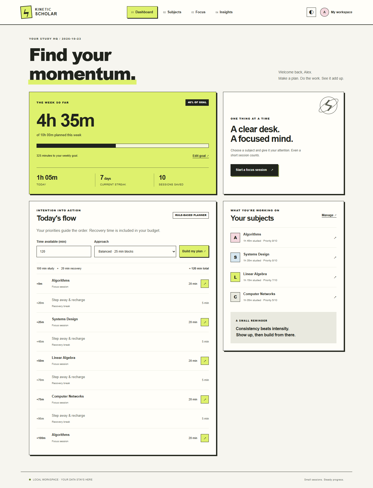

# Kinetic Scholar

**Make a plan. Find your focus. See the work add up.**

A local, single-user study workspace built with Flask, SQLite, and vanilla JavaScript. Subject priorities, time-budgeted plans, a recoverable focus timer, and honest study analytics connect in one small application.



## What works

- **Subjects:** add, rename, prioritize, search, archive, and restore up to 20 active subjects. Archiving preserves history.
- **Planning:** balanced or exam-preparation plans whose study blocks and five-minute breaks add up to the exact time budget. Plans persist for the current study day.
- **Focus:** start, pause, resume, and finish; restore a timer after navigation/reload; rate focus and difficulty before saving. One Focus tab controls the timer at a time.
- **Session logging:** save timer sessions or manually log completed work. Request IDs prevent retries from recording a session twice.
- **Insights:** daily/weekly study time, current streak, self-reported focus ratings, target versus actual allocation, and recent sessions.
- **Export:** download all sessions as CSV with spreadsheet-formula protection.
- **Workspace:** name, weekly goal, IANA time zone, light/dark themes, keyboard-friendly dialogs, and distraction-free mode.

No cloud account, API key, JavaScript build step, CDN, or internet connection is needed **after dependencies are installed**. Node is optional and used only for timer tests. This is a local workspace, with no online login or multi-user isolation.

## Quick start

Use Python **3.12 or newer**. Runtime dependencies are Flask, Waitress, and timezone data. The lockfile also pins their transitive dependencies.

### Windows PowerShell

```powershell
python -m venv .venv
.\.venv\Scripts\python.exe -m pip install -r requirements.lock
.\.venv\Scripts\python.exe app.py
```

### macOS / Linux

```bash
python3 -m venv .venv
.venv/bin/python -m pip install -r requirements.lock
.venv/bin/python app.py
```

Open **http://127.0.0.1:5000**. Stop the server with Ctrl+C. The app creates `instance/kinetic.sqlite3` on first launch and uses Waitress with debugging disabled and a loopback-only listener.

1. Set your profile and time zone on the dashboard.
2. Add subjects and importance scores on **Subjects**.
3. Generate a plan or open **Focus** directly.
4. Study for at least one minute, choose **Finish & save**, and submit feedback.
5. Open **Insights** to see the saved session and export your history.

Sessions default to 25 minutes, with a one-minute minimum. Manual entries record work already completed, not scheduled work.

## Try a separate demo workspace

This creates **synthetic data in a separate file** and refuses to overwrite existing data:

```powershell
.\.venv\Scripts\python.exe scripts/seed_demo.py
$env:KINETIC_DATABASE = (Resolve-Path instance/demo.sqlite3).Path
.\.venv\Scripts\python.exe app.py
```

On macOS/Linux:

```bash
.venv/bin/python scripts/seed_demo.py
KINETIC_DATABASE="$PWD/instance/demo.sqlite3" .venv/bin/python app.py
```

In PowerShell, run `Remove-Item Env:KINETIC_DATABASE` before starting your personal workspace again. Screenshots use the synthetic demo; they do not represent real student activity.

## Architecture

```text
Browser (server-rendered pages + small JavaScript modules)
  ├── Timer draft and theme → browser localStorage
  └── Same-origin JSON API → Flask → SQLite in instance/
                              ├── planning.py: bounded scheduling rules
                              └── analytics.py: session-derived statistics
```

SQLite is the source of truth for profiles, subjects, saved sessions, targets, and today's plan. The browser holds only theme preferences and unfinished session state. No process sends data elsewhere.

```text
app.py                 Factory, routes, validation, security boundaries
database.py            Schema and per-request connection lifecycle
planning.py            Integer allocation and bounded planning
analytics.py           Timezone-aware session aggregation
templates/             Shared layout and four product pages
static/css/            One offline stylesheet
static/js/             Page behavior and testable timer transitions
tests/                 API, persistence, planning, timer, browser checks
scripts/               Safe demo seed and release packaging
docs/                  Architecture, API, review guide, screenshots
.github/workflows/     Automated checks; no automatic publishing
```

Read [architecture and metric definitions](docs/architecture.md), [API reference](docs/api.md), and [local deployment/data handling](docs/deployment.md).

## Verification

Backend tests need only runtime dependencies. Timer tests use Node 22+ without an npm install:

```powershell
.\.venv\Scripts\python.exe -m unittest discover -s tests -v
node --test tests/timer.test.mjs
.\.venv\Scripts\python.exe scripts/check_release.py
```

Optional browser, lint, and dependency checks:

```powershell
.\.venv\Scripts\python.exe -m pip install -r requirements-dev.txt
.\.venv\Scripts\python.exe -m ruff check .
.\.venv\Scripts\python.exe -m pip_audit -r requirements.lock
.\.venv\Scripts\python.exe -m playwright install chromium
.\.venv\Scripts\python.exe tests/browser_check.py
```

With Microsoft Edge already installed, use `python tests/browser_check.py --channel msedge` instead of downloading Chromium. The browser check starts its own temporary workspace and never modifies personal study data. See the [review guide](docs/review.md).

CI is configured for Python 3.12/3.14 on Windows/Linux, plus timer tests, Chromium browser flows, lint, release checks, and a dependency audit. The workflow definition is not proof of a successful GitHub run; inspect Actions after your first push.

## Deliberate limits

- One local workspace. Do not expose its port publicly or treat trusted-host restrictions as authentication.
- Transparent planning rules, not AI inference. Importance guides ordering; adjacent blocks rotate when alternatives exist. A short budget may not include every subject.
- Focus ratings are self-reported, not measurements of learning, efficiency, or burnout.
- Timer deadlines catch up after tab throttling or computer sleep. If you stopped studying, discard the timer and manually log actual work; the app cannot detect attention or sleep.
- Drafts are browser-specific. Clearing browser storage removes drafts, not saved sessions. Save retries are accepted for seven days.
- Analytics reads history in memory, appropriate for personal logs. Very large datasets would need SQL aggregation/pagination.
- No remote sync or automatic backups. Keep private database backups.

## Contributing and license

See [CONTRIBUTING.md](CONTRIBUTING.md). Licensed under [MIT](LICENSE). The current interface uses CSS and an original geometric SVG mark; legacy reference artwork is excluded.
